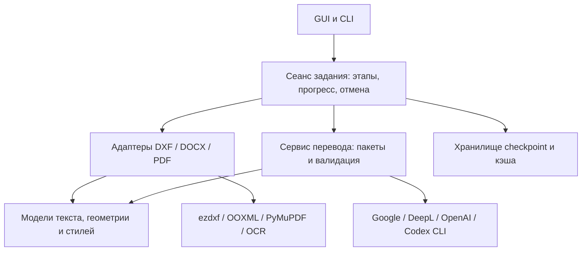

# Аудит Daru: корректность, производительность и архитектура

Дата первоначального аудита: 18 сентября 2026 года. Обновлено после исправлений по приоритетам: 19 сентября 2026 года. Проверена текущая рабочая копия, включая существовавшие незакоммиченные изменения. Изменения аудита внесены поверх неё без сброса чужой работы.

Исходные приоритеты: корректность обхода DXF, изоляция кэшей, ограничение памяти при обработке PDF и разделение тесно связанных компонентов. Реализована структура модульного монолита с отдельными адаптерами форматов и провайдеров. Ниже сохранены результаты каждого этапа; итоговые проверки приведены в разделе завершения оставшихся этапов.

## Исправлено в рамках аудита

| Проблема | Наблюдавшееся поведение | Изменение |
|---|---|---|
| Двойной обход DXF | Modelspace и paperspace встречались и среди layouts, и среди `doc.blocks`. Частоты удваивались; перевод `A → B` мог повторно стать `C` при наличии пары `B → C`. | Общие итераторы обхода исключают layouts из повторной обработки блоков. |
| Атрибуты вставок | `INSERT.attribs` извлекались, но не обрабатывались при записи перевода. | Один обход текстовых сущностей используется извлечением и применением; включены атрибуты обычных и вложенных вставок. |
| Размеры и выноски | Использовались отсутствующие у реальных сущностей методы; широкие обработчики исключений скрывали пропуски. | Размеры читаются и записываются через `DIMENSION.dxf.text`, выноски — через `get_mtext_content` / `set_mtext_content`. |
| Потеря MTEXT-форматирования | Чтение через `plain_text()` удаляло управляющие последовательности даже при пустой карте переводов; регулярное выражение пропускало текст после `\P`. | Сохраняется исходное содержимое MTEXT. Поддержаны точные переводы с сохранёнными управляющими кодами и замены видимых фрагментов. |
| Последовательные замены | Каждая подпись проверялась против всей карты, а вставленный перевод мог снова участвовать в замене. | `TextReplacer` строит словарь один раз. Точное совпадение ищется по ключу; для частичных совпадений используется лениво создаваемое выражение с приоритетом длинных исходных строк. Вставленный текст повторно не переводится. |
| Типы сущностей в контексте | Имя определения блока могло передаваться переводчику вместо типа сущности. | В метаданных сохраняются `TEXT`, `MTEXT`, `ATTRIB` и другие фактические типы. |
| Неполный ответ переводчика | `zip()` молча обрезал результат при несовпадении размеров пакетов. | `translate_many()` проверяет количество результатов и сообщает об ошибке. |
| Пробельные значения | Режим `noop` удваивал строку, состоящую только из пробелов. | Исходные пробельные значения сохраняются. Неположительный размер пакета отклоняется явно. |
| Повреждённый checkpoint | Нечисловое поле `version` могло завершить загрузку исключением. | Неподдерживаемая версия пропускается как несовместимый checkpoint. |
| Языки OCR | `en ru es` превращалось в `['en ru e']` из-за неверного экранирования `\s`. | Разделители распознаются корректно, коды языков сохраняются. |

Реализация общего обхода и замен: [entities.py](C:/Users/admin/Documents/Projects/daru/src/daru/dxf/entities.py:99), [extractor.py](C:/Users/admin/Documents/Projects/daru/src/daru/dxf/extractor.py), [applier.py](C:/Users/admin/Documents/Projects/daru/src/daru/dxf/applier.py).

Поведение `plain_text()` и доступ к тексту размеров дополнительно сверены с официальной документацией: [MTEXT](https://ezdxf.readthedocs.io/en/stable/dxfentities/mtext.html), [DIMENSION](https://ezdxf.readthedocs.io/en/stable/dxfentities/dimension.html). Атрибуты принадлежат вставке: [INSERT](https://ezdxf.readthedocs.io/en/stable/blocks/insert.html).

## Выполненное разделение модулей и очистка

`PdfProcessingConfig` перенесён в [pdf/config.py](C:/Users/admin/Documents/Projects/daru/src/daru/pdf/config.py), десять моделей данных — в [pdf/models.py](C:/Users/admin/Documents/Projects/daru/src/daru/pdf/models.py). Эти модули больше не импортируют конвейер, OCR, облачные клиенты или графические библиотеки и не создают каталог при импорте. Общие параметры Vision находятся в конфигурации; адаптер Vision использует их оттуда.

Публичные пути через `daru.pdf`, `daru.pdf.pipeline` и ранее доступные имена `_core` сохранены. Функции конвейера в корневом PDF-пакете загружаются по обращению. `_core.py` уменьшился с 6010 до 5618 строк. На этом этапе GUI ещё загружал конвейеры через `worker.py`; ниже приведены результаты последующей ленивой загрузки.

Удалены пять приватных функций, не имеющих вызовов в исходниках и тестах:

- `_has_pending_translation`;
- `_remove_block_text_background_aware`;
- `_has_translation`;
- `_estimate_font_size`;
- `_vertical_overlap_ratio`.

Удалены неиспользуемые импорты и локальные переменные. Устранено повторение логики чтения MULTILEADER в экстракторе. Публичные CLI-функции, `LegacyTranslationEngine`, экспортируемые классы и методы Qt оставлены: отсутствие прямого вызова в статическом анализе не доказывает, что они не используются.

В `pyproject.toml` добавлены зависимости разработки `pytest`, `ruff`, `vulture` и проверка Ruff по правилам `F`.

## Проверка после первоначального аудита (18 сентября)

| Проверка | Результат |
|---|---|
| Исходный набор тестов | 313 passed |
| После изменений | 342 passed; добавлено 29 проверок |
| Ruff: `src tests scripts` | Ошибок не найдено |
| Vulture: `src tests --min-confidence 80` | Замечаний не осталось |
| `git diff --check` | Успешно |
| Синтетические замены: 3000 подписей, 3000 пар | Последовательный алгоритм: 0,559 с; индексированный: 0,00325 с; около 172 раз быстрее в этом сценарии |
| Импорт PDF-конфигурации в отдельном процессе | Ориентировочно 1,49 с до разделения и 0,078 с после; тяжёлые модули теперь не загружаются |

Замер замен включает создание индекса и использует одинаковые результаты обоих алгоритмов. Это точные совпадения коротких строк, без API, чтения/записи DXF и выбора шрифтов. Частичные совпадения и большие регулярные выражения требуют отдельного профилирования. Время импорта — ориентировочный локальный замер, зависящий от файлового кэша и окружения.

Для воспроизведения:

```powershell
python -m pip install -e ".[dev]"
python -m pytest tests/ -q
python -m ruff check src tests scripts
python -m vulture src tests --min-confidence 80
python scripts/benchmark_dxf_replacements.py --items 3000 --repeat 3
```

Новые проверки используют настоящие объекты ezdxf, включая сохранение и повторное открытие DXF. Проверяется импорт PDF-моделей в отдельном процессе с запрещённой загрузкой OCR-библиотек. Реальные платные API, конвертация ODA, сборка EXE и нагрузка на больших пользовательских документах в этом аудите не запускались.

## Выполнено по приоритетам (19 сентября)

### P1 — корректность кэша и результатов

Автоматические checkpoint и слои PDF теперь проверяют SHA-256 документа, тип задания, нормализованную языковую пару и отпечаток настроек перевода. Он учитывает провайдера, модель, текст инструкции и параметры генерации; для Codex также модель и параметры анализа. Ключи API в отпечаток и метаданные не записываются. Старые результаты без отпечатка при автоматическом продолжении пропускаются. Проверка наличия checkpoint в GUI использует те же инструкции и параметры, что и конвейер.

CSV из `--map-csv` используется для экспорта. Для явного глоссария добавлен `--glossary-csv`; его содержимое входит в отпечаток CAD-задания. Изменение глоссария, исходного документа, целевого языка или модели не позволяет подставить несовместимый сохранённый результат. Старые JSON-слои можно читать через функции совместимости; автоматическое использование требует новой идентификации.

Дополнительно обнаружено и исправлено опасное условие в OCR-кэше: Textract мог вернуть ответ для другого изображения только по совпадению длины JPEG/PNG в байтах. Теперь требуется совпадение SHA-256 изображения, страницы и признаков запроса; при известном SHA-256 документа проверяется и он. Загрузчик журнала удерживает только записи текущего документа. При попадании в кэш клиент AWS не инициализируется.

Для нативного PDF сопоставление блока по тексту и координатам ограничено той же страницей. Для сканированного PDF автоматическое применение слоя использует стабильный идентификатор или исходный текст, без позиционного `render_id`, который может измениться после повторного OCR/Vision.

На границе провайдера проверяются количество и тип значений, непустые переводы, полный набор идентификаторов, отсутствие дубликатов и лишних идентификаторов. Ошибки Google/DeepL и неполные ответы OpenAI/Codex больше не заменяются исходным текстом с последующей записью как успешного пакета. Режим `noop`, пробельные строки и намеренно пропущенные обозначения сохраняются. Для DeepL убран цикл дополнительных запросов по одному элементу после неудачи общего пакета.

Реализация: [options.py](C:/Users/admin/Documents/Projects/daru/src/daru/translation/options.py), [contracts.py](C:/Users/admin/Documents/Projects/daru/src/daru/translation/contracts.py), [checkpoint.py](C:/Users/admin/Documents/Projects/daru/src/daru/translation/checkpoint.py), [layers.py](C:/Users/admin/Documents/Projects/daru/src/daru/pdf/layers.py).

### P1 — память при переводе сканированных PDF

Poppler вызывается отдельно для каждой страницы. Исходные и подготовленные изображения хранятся во временном каталоге, декодированные пиксели освобождаются между страницами. OCR-модели и текст всего документа остаются доступны анализу и переводу; маски создаются только при обработке соответствующей страницы. При успешном завершении, ошибке OCR, рендеринга или экспорта временное хранилище закрывается.

Сохраняются физические размеры страниц и редактируемый текст. Проверены повторное открытие PDF, извлечение переведённого текста и визуальный рендер тестового документа. Основная стоимость по памяти теперь зависит от размера обрабатываемой страницы, текстовых метаданных и сжатого выходного PDF. Временные PNG требуют места на диске. Публичный вспомогательный `process_pdf()`, возвращающий список изображений вызывающему коду, сохраняет прежний контракт с этим списком в памяти.

Реализация: [pages.py](C:/Users/admin/Documents/Projects/daru/src/daru/pdf/pages.py), [потоковый тест](C:/Users/admin/Documents/Projects/daru/tests/test_pdf_streaming.py), [измерение памяти](C:/Users/admin/Documents/Projects/daru/scripts/benchmark_pdf_memory.py).

### P2 — разделение движка и повторяющейся логики

`TranslationEngine` остаётся совместимым фасадом. Адаптеры Google, DeepL, OpenAI и Codex вынесены в `translation/providers/`. Общие параметры, контекст документа, проверка пакетов, разбиение текста и инструкции форматов находятся в отдельных модулях. В CAD, DOCX и обоих PDF-конвейерах используется единый `TranslationOptions`, без повторения длинных конструкторов движка.

Движок уменьшился с 1313 до 671 строки. Бывший метод OpenAI на 363 строки разделён на перевод пакета, подготовку инструкции, выбор транспорта, запрос с повторными попытками и разбор ответа; основной метод адаптера занимает 81 строку. SDK получает учётные данные через параметры клиента, без изменения переменных окружения процесса при каждом создании движка.

Чтение слоя PDF выполняется один раз с построением индексов; запись и чтение перенесены в `pdf/layers.py`. В новом формате удалено дублирование одного массива под ключами `blocks` и `regions`; старые варианты поддержаны на чтение. Сериализация настроек, слоёв и checkpoint использует общий атомарный JSON writer. Из checkpoint убрана повторная сортировка всего набора перед записью.

### P2 — GUI, отмена, настройки и расположение файлов

Добавлен общий `CancellationToken`: проверки между страницами, пакетами, этапами и попытками запросов. Кнопка отмены уведомляет ожидающий `Condition`; закрытие окна запрашивает отмену и откладывает уничтожение окна до завершения потока. Выполняющийся сетевой запрос или внешняя команда завершает текущую операцию либо достигает таймаута. Механизм не предполагает мгновенного прерывания сторонней библиотеки.

GUI загружает конвейер выбранного формата только при запуске задания. Импорт главного окна больше не загружает PDF `_core` и ezdxf.

`AppSettings` допускает только поля dataclass, проверяет типы, отклоняет NaN/Infinity, повреждённую структуру и неправильную кодировку, нормализует числовые границы. Имена методов больше нельзя перезаписать ключами JSON. Неудачная атомарная замена сохраняет прежний файл настроек.

Кэш PDF перенесён из каталога исходников в `~/.daru/cache/pdf`. `DARU_DATA_DIR` позволяет изменить общий корень данных, включая checkpoint. Известные старые файлы копируются при обработке PDF без удаления оригиналов или перезаписи новых файлов; импорт модулей не создаёт каталогов.

Реализация: [job.py](C:/Users/admin/Documents/Projects/daru/src/daru/translation/job.py), [worker.py](C:/Users/admin/Documents/Projects/daru/src/daru/gui/worker.py), [paths.py](C:/Users/admin/Documents/Projects/daru/src/daru/utils/paths.py).

### P3 — DOCX

Загрузчик держит в памяти только текстовые XML-части. Изображения и остальные неизменяемые элементы ZIP копируются потоково с сохранением метаданных элементов; атомарная замена выходного DOCX сохранена. Тест запрещает чтение бинарного вложения целиком и проверяет равенство его содержимого после экспорта.

## Итоговая проверка (19 сентября)

| Проверка | Результат |
|---|---|
| Полный набор тестов | **396 passed**, 15,52 с; 54 новых проверки после первоначальных 342 |
| Ruff: `src tests scripts` | Ошибок нет |
| Vulture: `src tests --min-confidence 80` | Замечаний нет |
| `git diff --check` | Успешно |
| Пиковая память, 12 синтетических страниц A4, 150 DPI | **365,7 → 173,1 МБ**, снижение примерно на 53% |
| Пиковая память новой версии, 2 / 12 страниц | 160,9 / 173,1 МБ |
| Время синтетического задания, 12 страниц | 1,22 → 1,69 с; временные файлы добавляют ввод/вывод |
| Импорт главного окна в отдельном процессе | 2,39 → 0,67 с; PDF-конвейер и ezdxf отсутствуют в `sys.modules` |

Замеры локальные, однократные, зависят от кэша файлов и окружения. Для памяти использован Windows PeakWorkingSetSize всего процесса, включая библиотеки. OCR и перевод заменены детерминированными заглушками; растровые страницы, очистка, экспорт и файловое хранилище реальные. Это проверка масштабирования памяти, а не скорость платных API или качество перевода. Для воспроизведения предыдущей версии скрипт принимает `--package-path <старый checkout>/src`.

Тесты дополнительно покрывают смену языка и модели на реальном нативном PDF, повторное использование слоя сканированного PDF, ошибки провайдеров, отмену настоящего QThread, пробуждение ожидания анализа, сбой записи настроек и потоковое копирование вложений DOCX. Реальные платные API, ODA и сборка EXE не запускались.

## Завершение оставшихся этапов (19 сентября)

### P1 — стоимость больших checkpoint

По умолчанию новые задания используют `*.checkpoint.sqlite3`. Запись завершённого пакета обновляет только изменённые строки и метаданные одной транзакцией. Повторное сохранение без изменений не пишет файл. Используется стандартный `sqlite3` Python; дополнительная зависимость не нужна. Сохранены синхронные транзакции с `synchronous=FULL`; замер не ускорялся отключением гарантий записи. Механизм основан на [транзакциях SQLite](https://www.sqlite.org/atomiccommit.html) и [режимах синхронизации](https://www.sqlite.org/pragma.html#pragma_synchronous).

Совместимый JSON с тем же именем импортируется автоматически после проверки документа, языков и отпечатка настроек. Оригинал сохраняется. Явный путь `.json` сохраняет старый формат. Сброс оставляет пустой SQLite checkpoint с новым поколением: это предотвращает повторный импорт старого JSON и запрещает старому процессу дописывать результаты. Два процесса одного поколения могут сохранять разные блоки без потери записей друг друга. Повреждённая или чужая база отклоняется при открытии задания, до запросов перевода, без перезаписи её данных или режима журналирования.

| Сценарий, пакет 50 фрагментов | Прежний JSON | SQLite |
|---|---:|---:|
| 2 000 фрагментов, полное время записи | 0,896 с | 0,270 с |
| 10 000 фрагментов, полное время записи | 20,554 с | 1,393 с |
| 10 000 фрагментов, только вызовы `save()` | 20,533 с | 1,288 с |
| Чтение 10 000 фрагментов | 0,066 с | 0,066 с |
| Размер файла с 10 000 фрагментами | 6,413 МиБ | 5,078 МиБ |

Это локальный синтетический замер с одинаковыми текстами и координатами, без сети и OCR. В сценарии на 10 000 фрагментов полное время уменьшилось примерно в 14,8 раза; чтение почти не изменилось. Старый backend измерен из сохранённой рабочей копии до этого этапа. Скрипт [benchmark_checkpoints.py](C:/Users/admin/Documents/Projects/daru/scripts/benchmark_checkpoints.py) принимает `--package-path` и `--format json|sqlite3`.

Регрессии проверяют откат всего неудачного пакета и повторную попытку, аварийный выход отдельного процесса с незавершённой транзакцией, миграцию, несовместимые настройки, сброс, старый пишущий процесс, изоляцию снимков метаданных и продолжение реального DXF после сбоя. Чужая база проверяется в режимах DELETE и WAL.

### P2 — независимые этапы PDF

`_core.py` уменьшился с 5459 до 972 строк и отвечает за оркестрацию и совместимые экспорты. Выделены `raster`, `ocr`, `textract`, `geometry`, `imaging`, `regions`, `block_translation`, `rendering`, `export` и небольшие общие функции в `common`. Этапы не импортируют `_core` или `pipeline`; геометрия импортируется без NumPy, OCR, Qt и сетевых клиентов. Публичные классы и функции доступны через прежние фасады. Зависимости в тестах подменяются в модуле, который ими владеет.

Перенос функций проверен сравнением AST, затем тестами и отрисовкой трёх синтетических страниц: таблица и графика, вертикальная подпись, абзац на цветном фоне. Непосредственно после переноса шесть растровых изображений совпали пиксель в пиксель, извлекаемый текст — полностью. В итоговой версии фоны всех трёх страниц и извлекаемый текст также совпадают с исходной версией; намеренные визуальные изменения касаются описанных ниже исправлений привязки и цвета.

Отдельно исправлены обнаруженные дефекты:

- Textract создаёт клиент при промахе кэша вложенного рисунка, даже если целая страница ранее прочитана из кэша без клиента AWS.
- Растровые заголовки и обычный текст привязываются к видимому исходному тексту, а не к расширенному краю области очистки. Геометрия текстовой рамки общая с редактируемым PDF. Изменение растрового результата здесь намеренное; границы очистки, таблицы и графика сохраняются.
- При оценке цвета тонких букв отбираются пиксели, отличающиеся от фона. Раньше светлые промежутки внутри рамки слова могли сделать чёрную подпись серой. Добавлены проверки редких тёмных, светлых и цветных штрихов.

Воспроизводимый пример: [pdf_regression_fixture.py](C:/Users/admin/Documents/Projects/daru/scripts/pdf_regression_fixture.py). Текущие локальные артефакты находятся в `tmp/pdfs/refactor-final/`; они не включаются в репозиторий. Проверены изображения страниц, извлечение текста и отсутствие предупреждений при вставке редактируемого слоя.

### P2 — единый прогресс задания

В [progress.py](C:/Users/admin/Documents/Projects/daru/src/daru/translation/progress.py) введены неизменяемые `ProgressEvent` и подписка через `progress_scope`. DXF, DOCX, нативный и сканированный PDF сообщают этапы чтения, OCR/анализа, перевода, применения и экспорта. Счётчики относятся к текущему этапу, учитывают уже доступные переводы и обновляются после сохранения пакета. GUI получает объекты через сигнал worker и обновляет строку состояния без разбора строк журнала.

Подписки изолированы между потоками и восстанавливаются после исключений во вложенном контексте. Только worker сообщает успешное завершение после возврата конвейера и проверки отмены. Вложенный OCR в гибридном PDF не завершает родительское задание. Поздние обновления не заменяют сообщение об отмене или ожидании диалога анализа.

### Итоговая проверка

| Проверка | Результат |
|---|---|
| Полный набор pytest | **426 passed**, 16,81 с |
| Ruff: `src tests scripts` | Ошибок нет |
| Vulture: `src tests --min-confidence 80` | Замечаний нет |
| `git diff --check` | Успешно |
| Регрессия PDF | Совпадают извлекаемый текст и фон; исправлены привязка растрового текста и цвет тонких букв |

Перед выпуском остаются проверки на пользовательских многостраничных чертежах, реальных платных API, ODA и собранном EXE. Эти внешние интеграции в данном прогоне не запускались. Отмена остаётся кооперативной: выполняющийся внешний запрос ограничен поведением и таймаутом клиента.

## Рекомендуемая архитектура

Принятая структура — модульный монолит. Адаптеры провайдеров, общие параметры, проверка пакетов, отмена, прогресс, хранилище и независимые этапы PDF выделены. Специфичные модели форматов сохранены.



Модели данных и настройки не должны импортировать GUI, сетевые клиенты или OCR. Адаптер формата отвечает за извлечение, сохранение идентификаторов и геометрии, применение результата и экспорт. Сервис перевода работает с текстовыми единицами, их идентификаторами и контекстом документа. Контекст задания связывает отмену и события прогресса; GUI отображает события и ввод пользователя.

Общей текстовой модели не следует вытеснять специфичные модели DXF/PDF/DOCX: форматирование и геометрия остаются у адаптера. Интерфейсы провайдера и хранилища можно описать небольшими `typing.Protocol`, поддерживаемыми в Python 3.10. [Документация Protocol](https://docs.python.org/3/library/typing.html#typing.Protocol).

Запланированные этапы профилирования checkpoint, выделения Textract/OCR и рендеринга, а также унификации событий прогресса выполнены. Следующие изменения алгоритмов следует выбирать по замерам и воспроизводимым документам, сохраняя публичные пути импорта и специфичные модели DXF/PDF/DOCX.

После смены извлечения MTEXT старые карты с очищенным текстом могут не совпасть с исходной строкой, содержащей коды форматирования. Такие фрагменты могут потребовать повторного перевода. Набор регрессионных тестов охватывает проверенные управляющие последовательности; он не заменяет визуальной проверки произвольных чертежей в CAD.
